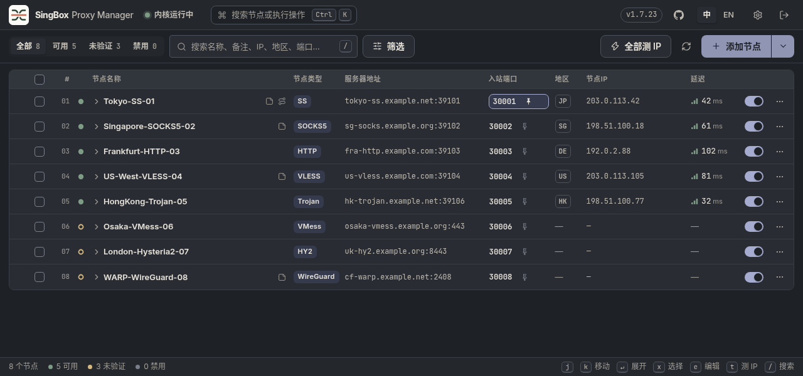
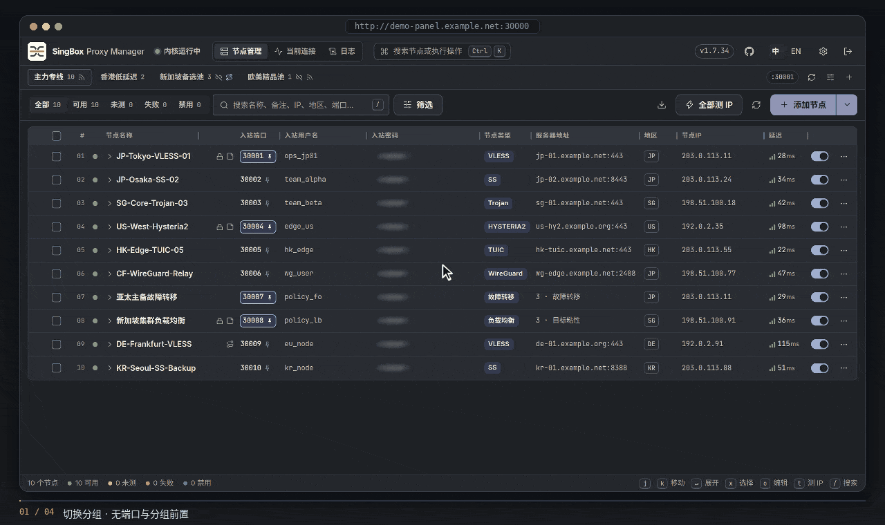
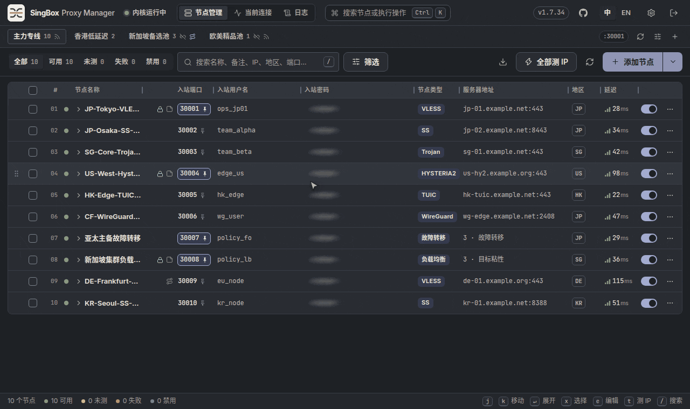
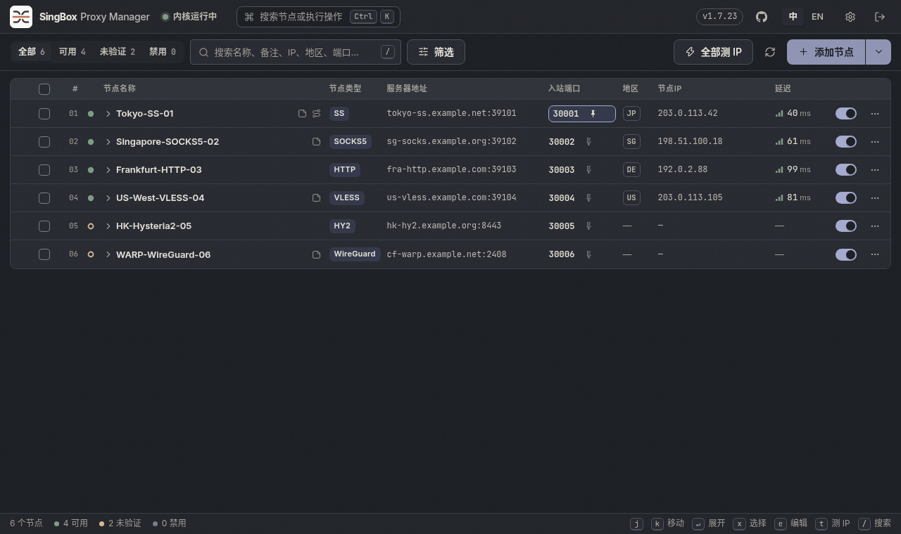

<div align="center">
  
  <h1>SingBox Proxy Manager</h1>
  <p><strong>基于 sing-box 内核的轻量代理转发与 Web 管理面板</strong></p>
  <p>将各类主流协议节点集中管理，一键转为独立的本地 HTTP / SOCKS5 混合代理端口</p>

  <p>
    <a href="https://github.com/cheluen/singbox-proxy-manager/releases"></a>
    <a href="LICENSE"></a>
    
    
  </p>

  <p>
    <a href="#免责声明">免责声明</a> ·
    <a href="#产品简介与功能展示">功能展示</a> ·
    <a href="#真实操作演示">操作演示</a> ·
    <a href="#支持的协议一览">支持协议</a> ·
    <a href="#部署指南">部署指南</a> ·
    <a href="#三步快速上手">快速上手</a> ·
    <a href="#进阶技术文档">技术文档</a> ·
    <a href="#开源许可证">许可证</a>
  </p>
</div>

---

## 免责声明

> [!WARNING]
> 本项目仅用于网络协议技术学习、跨地域网络测试与合法合规的自建代理运维管理。
> - 本项目**不提供**任何代理节点、订阅服务或穿透工具；项目源码与文档中的所有地址与配置均为演示占位数据。
> - 请严格遵守您所在国家或地区的法律法规，**严禁**将本项目用于任何违法违规或未获授权的网络活动。
> - 任何因使用、修改或分发本项目所产生的法律责任与风险均由使用者自行承担，项目作者与贡献者不承担任何直接或间接责任。

---

## 产品简介与功能展示

**SingBox Proxy Manager** 是一个自带 Web 管理面板的 `sing-box` 代理转发管理系统。

简单来说，当你手里有一批不同协议的代理节点（例如 Shadowsocks、VLESS、VMess、Trojan、Hysteria2、TUIC、AnyTLS、WireGuard 等），不想在每台设备或每个业务脚本里分别配置复杂的客户端时，只需要在一台服务器上部署它：它会通过**单个常驻 `sing-box` 内核**，自动把每个节点转换成一个开箱即用的本地 **HTTP + SOCKS5 混合代理端口**，并在浏览器里完成导入、测速、认证、排序、中转与监控。

### 面板全景预览

<p align="center">
  
</p>

### 为什么好用？核心功能一览

- **开箱即用，零外部依赖**：官方发行版将前端面板与固定版本 `sing-box 1.12.12` 内核打包为**单个可执行文件**，下载后无需再单独安装 Node.js 或手动配置 `sing-box`。
- **12 种主流协议统一接入**：支持 Direct、Shadowsocks、VLESS（含 Reality / XTLS-Vision）、VMess、Trojan、Hysteria2、TUIC、AnyTLS、SOCKS5 / SOCKS5H、HTTP / HTTPS 与 WireGuard（含 Cloudflare WARP 保留字节与多 Peer JSON）。
- **「暮色」暗色指挥台面板**：低饱和暗色高密度列表，点击节点即可在**行内原位展开**连接地址、出口 IP/地区/延迟、端口固定、前置代理与备注；支持 `Ctrl/⌘ + K` 命令面板、全键盘快捷键（`j/k`、`Enter`、`x`、`e`、`t`）及中英文一键切换。
- **批量导入与一键出口检测**：支持一次性粘贴多行分享链接、Base64 订阅、远程订阅 URL 及 Clash YAML 节点列表；导入后自动分配端口与随机账密，并可一键并发检测出口 IP、国家/城市与延迟。
- **进阶转发与灵活管理**：
  - **链式前置代理**：支持配置「全局前置代理」或「单节点自定义前置代理」，内置防环路保护与前置独立测 IP。
  - **TCP 复用单端口路由**：通过 `<用户名>+<目标端口>` 认证规则，连接任意带认证入站端口即可动态路由到其他已开启复用的出站节点。
  - **端口固定与保留模式**：支持自动顺延分配 + 单节点固定端口，也可开启「保留入站端口」确保拖拽排序与删除不影响客户端已有端口配置。
  - **批量高效维护**：支持批量测 IP、批量设置或随机生成入站账密、批量导出分享链接、手动出站去重及批量删除。
- **稳定可靠与安全底盘**：配置变更先经 `sing-box check` 校验再原子切换，异常退出支持指数退避自动恢复与 `last-good` 降级保护；默认开启登录防爆破与无默认密码强制初始化；除开箱即用的本地 SQLite 外，还支持 PostgreSQL、MySQL/TiDB 与 Turso/libSQL 远程存储。

### 真实操作演示

#### 1. 面板登录、行内详情展开、双语切换与 `Ctrl/⌘ + K` 命令面板

无需在多个页面之间反复跳转，点击节点行直接原位查看并一键复制 HTTP / SOCKS5 代理地址或 `curl` 测试命令；随时按 `Ctrl/⌘ + K` 快速检索并直达目标节点或常用操作。

<p align="center">
  
</p>

#### 2. 批量导入多协议分享链接与一键并发出口 IP 检测

直接粘贴多条不同协议的分享链接或订阅内容，系统自动校验配置、分配入站端口并生成高强度随机入站账密，随后并发探测每个节点的真实出口地区、IP 与响应延迟。

<p align="center">
  
</p>

#### 3. 批量认证与导出、链式前置代理及全局系统设置

勾选多个节点即可呼出底部悬浮批量操作栏，统一重置随机入站账密或导出 `sbpm-nodes.txt`；在节点或系统设置中轻松配置链式前置代理、起始端口、保留端口策略与管理员密码。

<p align="center">
  
</p>

### 支持的协议一览

| 协议类型 | 面板表单 | 分享链接导入 | 分享链接导出 | Clash YAML 导入 |
| --- | :---: | :---: | :---: | :---: |
| Shadowsocks (`ss`) | 支持 | `ss://` | 支持 | 支持 |
| VLESS (`vless`, 含 TLS / Reality) | 支持 | `vless://` | 支持 | 支持 |
| VMess (`vmess`) | 支持 | `vmess://` | 支持 | 支持 |
| Trojan (`trojan`) | 支持 | `trojan://` | 支持 | 支持 |
| Hysteria2 (`hy2`) | 支持 | `hy2://` / `hysteria2://` | 支持 | 支持 |
| TUIC (`tuic`) | 支持 | `tuic://` | 支持 | 支持 |
| AnyTLS (`anytls`) | 支持 | `anytls://` | 支持 | 支持 |
| WireGuard (`wireguard`, 含 WARP / 多 Peer) | 支持 | `wg://` / `wireguard://` | 仅单 Peer | 支持 |
| SOCKS5 / SOCKS5H (`socks5` / `socks5h`) | 支持 | `socks://` / `socks5://` / `socks5h://` | 支持 | 支持 |
| HTTP / HTTPS (`http`) | 支持 | `http://` / `https://` | 支持 | 支持 |
| Direct 本地直连 (`direct`) | 支持 | 不支持 | 不支持 | 不支持 |

---

## 部署指南

根据你的服务器环境任选一种方式即可，**两分钟内即可跑起来**：

| 部署方式 | 适合人群 | 系统/架构要求 |
| --- | --- | --- |
| **[方式一：Docker Compose（推荐）](#方式一docker-compose-一键部署)** | 已安装 Docker，希望自动拉取镜像、最省心升级 | Linux（`amd64` / `arm64`） |
| **[方式二：单文件二进制直跑](#方式二单文件二进制直接运行)** | 未安装 Docker，或运行在 macOS / FreeBSD / 轻量 VPS | Linux / macOS / FreeBSD（`amd64` / `arm64`） |

### 方式一：Docker Compose 一键部署

> 前置准备：一台已安装 [Docker Engine](https://docs.docker.com/engine/install/) 与 Docker Compose 插件的 Linux 服务器。

#### 第 1 步：获取部署文件

```bash
git clone https://github.com/cheluen/singbox-proxy-manager.git
cd singbox-proxy-manager
```

#### 第 2 步：创建 `.env` 并设置管理员密码

```bash
cp .env.example .env
chmod 600 .env
```

用任意编辑器打开 `.env`（例如 `nano .env` 或 `vim .env`），找到 `ADMIN_PASSWORD=` 这一行，填入你自己的强密码并保存：

```dotenv
# 首次启动必须设置非空密码（不支持默认密码，上限 72 字节）
ADMIN_PASSWORD=请替换为你的高强度密码
```

> 提示：默认管理端口为 `30000`，节点入站端口默认从 `30001` 开始顺延分配，数据保存在同目录的 `./config`。如需调整管理端口，可在 `.env` 中修改 `PORT=30000`。

#### 第 3 步：启动服务

```bash
docker compose --profile ghcr up -d
```

查看运行状态与日志，确认无报错：

```bash
docker compose --profile ghcr ps
docker compose --profile ghcr logs --tail=50
```

现在打开浏览器访问 **`http://<你的服务器IP>:30000`**，输入刚才设置的管理员密码即可进入面板！

<details>
<summary><strong>展开查看：Docker 版本升级与本地源码构建方式</strong></summary>

- **升级到最新预构建镜像**（配置与数据库会自动保留在 `./config`，切勿使用 `down -v`）：
  ```bash
  docker compose --profile ghcr pull
  docker compose --profile ghcr up -d
  ```

- **改用本地源码构建镜像**：
  ```bash
  # 若当前正在运行 ghcr 容器，先停止以避免同名容器冲突
  docker compose --profile ghcr down

  # 在 .env 中可将 COMPOSE_PROFILES 改为 local，或直接通过 --profile local 启动
  docker compose --profile local up -d --build
  ```

</details>

---

### 方式二：单文件二进制直接运行

如果你不想装 Docker，可以直接从 [GitHub Releases](https://github.com/cheluen/singbox-proxy-manager/releases) 下载对应系统的单个可执行文件——**前端页面和 `sing-box 1.12.12` 内核已经全部内置在文件里**，直接运行即可。

#### 第 1 步：下载程序并校验完整性（以 Linux `amd64` 为例）

```bash
mkdir -p singbox-proxy-manager && cd singbox-proxy-manager

APP_VERSION=1.7.23
OS=linux      # 可选：linux / darwin / freebsd
ARCH=amd64    # 可选：amd64 / arm64

curl -fsSLO "https://github.com/cheluen/singbox-proxy-manager/releases/download/v${APP_VERSION}/singbox-proxy-manager-${OS}-${ARCH}"
curl -fsSLO "https://github.com/cheluen/singbox-proxy-manager/releases/download/v${APP_VERSION}/checksums.txt"

sha256sum --ignore-missing -c checksums.txt
chmod 700 "singbox-proxy-manager-${OS}-${ARCH}"
```

#### 第 2 步：写入首次管理员密码并启动

在可执行文件同目录创建 `.env` 文件（权限设为仅本人可读）：

```bash
cat > .env <<'EOF'
PORT=30000
BIND_ADDRESS=0.0.0.0
CONFIG_DIR=./config
ADMIN_PASSWORD=请替换为你的高强度密码
EOF
chmod 600 .env
```

启动服务（若在新终端运行，请将 `${OS}-${ARCH}` 替换为实际文件名，如 `linux-amd64`）：

```bash
"./singbox-proxy-manager-${OS}-${ARCH}"
```

看到服务监听提示后，访问 **`http://<你的服务器IP>:30000`** 即可登录。数据与自动释放的 `sing-box` 内核都会保存在同目录的 `./config` 下。

<details>
<summary><strong>展开查看：单文件后台常驻（systemd）与无缝升级说明</strong></summary>

- **原地升级**：先停止旧进程，下载新版本二进制替换旧文件，保留原工作目录、`.env` 与 `./config` 后重新启动即可，节点与密码均完整保留。
- **使用 `systemd` 后台运行示例**（按实际目录调整路径）：
  ```ini
  [Unit]
  Description=SingBox Proxy Manager
  After=network-online.target

  [Service]
  Type=simple
  WorkingDirectory=/opt/singbox-proxy-manager
  ExecStart=/opt/singbox-proxy-manager/singbox-proxy-manager-linux-amd64
  Restart=on-failure
  RestartSec=5

  [Install]
  WantedBy=multi-user.target
  ```

</details>

---

## 三步快速上手

1. **登录与改密**：用 `.env` 中的 `ADMIN_PASSWORD` 登录面板；后续可点击右上角齿轮进入「系统设置」直接修改管理员密码（至少 8 位，修改后旧会话立即失效）。
2. **导入节点并测速**：点击右上角「添加 → 批量导入」，粘贴分享链接、Base64 或订阅内容并点击「导入」；系统会自动分配本地端口（默认 `30001` 起）与入站账密，并并发检测出口 IP 与延迟。
3. **开始使用代理**：点击任意节点行展开详情，在「连接方式」卡片中一键复制 HTTP / SOCKS5 代理地址或 `curl` 命令：
   ```bash
   # HTTP 代理测试示例（端口、用户名与密码请以面板「连接方式」卡片为准）
   curl -x "http://用户名:密码@你的服务器IP:30001" http://httpbin.org/ip

   # SOCKS5 代理测试示例
   curl --socks5-hostname "用户名:密码@你的服务器IP:30001" http://httpbin.org/ip
   ```

> [!TIP]
> **安全使用提醒**
> - 如需在公网访问管理面板，强烈建议将 `BIND_ADDRESS` 设为 `127.0.0.1`，前置 Nginx / Caddy 提供 HTTPS，并在 `.env` 中配置 `TRUSTED_PROXIES`。
> - 节点入站端口默认监听所有网卡（`::`），请务必在云安全组或防火墙中限制可信来源 IP，并保持节点「入站认证」处于开启状态。

---

## 进阶技术文档

所有架构原理、完整环境变量、远程数据库配置、协议规范、HTTP API 与开发测试指南均整理在 [`docs/`](docs/README.md) 目录中：

| 文档 | 说明 |
| --- | --- |
| [系统架构与核心机制](docs/architecture.md) | 单常驻内核模型、内置内核与预压缩前端、原子变更与自愈、端口与 TCP 复用、链式防环路及安全边界 |
| [配置、数据库与运维指南](docs/configuration.md) | 全部环境变量参考、SQLite / PostgreSQL / MySQL / Turso 接入与单实例租约、数据目录与故障排查 |
| [协议支持与导入导出规范](docs/protocols.md) | 12 种出站协议字段、15 种 URI Scheme 与 Clash 导入边界、导出限制及出站去重规则 |
| [HTTP API 参考](docs/api.md) | 鉴权方式与全部 26 个接口的入参、出参与状态码说明 |
| [本地开发、构建与测试指南](docs/development.md) | Go 1.26.11 + sing-box 1.12.12 安全重编译、本地联调、完整测试矩阵与 CI/CD 流水线 |

---

## 开源许可证

本项目采用 [MIT License](LICENSE) 开源许可协议。
