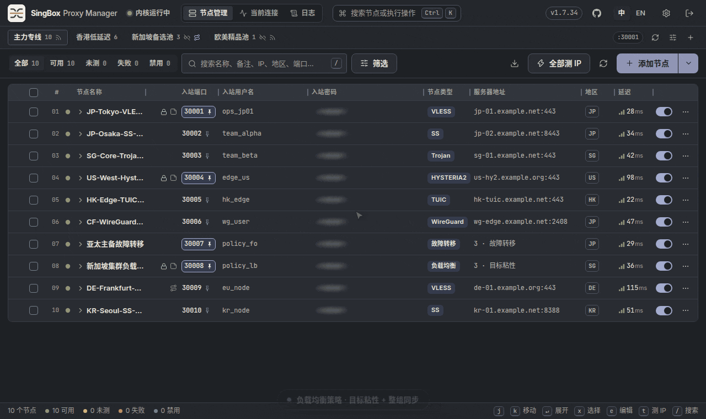

<div align="center">
  
  <h1>SingBox Proxy Manager</h1>
  <p><strong>基于 sing-box 内核的轻量代理转发与 Web 管理面板</strong></p>
  <p>集中管理各类代理节点，在浏览器里完成导入、测速、分组、策略调度，并转为本地 HTTP / SOCKS5 或 HTTPS 代理端口</p>

  <p>
    <a href="https://github.com/cheluen/singbox-proxy-manager/releases"></a>
    <a href="LICENSE"></a>
    
    
  </p>

  <p>
    <a href="#免责声明与合规说明">免责声明</a> ·
    <a href="#核心功能">核心功能</a> ·
    <a href="#界面与操作演示">操作演示</a> ·
    <a href="#支持协议">支持协议</a> ·
    <a href="#快速部署">快速部署</a> ·
    <a href="#三步上手">三步上手</a> ·
    <a href="#文档索引">文档索引</a> ·
    <a href="#开源许可证">许可证</a>
  </p>
</div>

---

## 免责声明与合规说明

> [!WARNING]
> 本项目仅用于合法的网络协议学习、开发调试、内网运维管理与合规测试。
> - 本项目**不提供**任何代理节点、服务器、订阅服务或网络穿透服务；源码、文档与演示画面中的地址和凭据均为占位示例。
> - 使用者须严格遵守所在地、部署地、网络接入地及目标访问地等所有适用司法管辖区的法律法规，严禁将本项目用于任何违法违规或未获授权的活动。
> - 因使用、修改或分发本项目产生的法律责任与风险均由使用者自行承担；在适用法律允许的最大范围内，作者与贡献者不承担任何直接、间接或连带责任。
> - **首次启动协议确认**：启动前须阅读并同意完整的 [用户协议（USER_AGREEMENT.md）](USER_AGREEMENT.md)（默认未同意，程序会拒绝启动）：
>   - **二进制终端直接运行**：首次启动会自动打印协议正文，输入 `y` 回车同意后继续运行并保存同意记录。
>   - **Docker 或后台服务部署**：请在 `.env` 中显式设置 `ACCEPT_USER_AGREEMENT=true` 后启动。

---

## 简介

当你手里有一批不同协议的代理节点，不想在每台设备或每个业务脚本里分别折腾客户端配置时，可以把 **SingBox Proxy Manager** 部署在一台服务器上。

它内置 Web 管理面板与固定版本 `sing-box` 内核，让你在浏览器里一站式完成导入、测速、分组和策略编排，并按需把节点暴露成开箱即用的本地 **HTTP / SOCKS5（Mixed）** 或 **HTTPS (TLS)** 代理端口。

<p align="center">
  
</p>

---

## 核心功能

| 模块 | 能帮你做什么 | 进阶说明 |
| --- | --- | --- |
| **开箱即用** | 官方发行版已打包前端面板与 `sing-box` 内核，单个可执行文件或 Docker 容器直接启动，免配运行环境 | [开发与构建](docs/development.md) |
| **多协议与批量导入** | 支持 12 种实体节点类型；一次性粘贴分享链接、Base64、Clash YAML 或订阅 URL，自动分配端口与账密并并发测速 | [协议与导入导出](docs/protocols.md) |
| **节点分组与订阅** | 按用途划分分组、拖拽排序；每组独立控制是否分配端口、起始端口、保留入站端口及定时增量订阅同步 | [架构与分组机制](docs/architecture.md) |
| **故障转移与负载均衡** | 内置「故障转移」和「负载均衡（轮询 / 目标粘性）」策略节点，支持跨组选成员或整组关联自动同步与一键断链 | [策略与 API](docs/api.md) |
| **前置代理与加密入站** | 支持单节点 / 分组 / 全局三级优先级前置代理、Mixed 与 HTTPS (TLS) 加密入站切换，以及单端口 TCP 复用路由 | [配置与运维](docs/configuration.md) |
| **实时连接与日志流量** | 三栏实时链路流图直观查看「客户端 → 入站 → 出站 / 策略 / 前置」速率与路径高亮，支持内存日志及可选持久化统计 | [架构与观测](docs/architecture.md) |
| **高效率暗色面板** | 列宽拖拽自动保存、毛玻璃密码点按显隐、行内三栏详情一键复制 `curl` / 代理地址、`Ctrl/⌘ + K` 跨组快搜、中英双语 | [HTTP API](docs/api.md) |

---

## 界面与操作演示

### 1. 日常管理：分组切换、详情一键复制、命令面板与中英双语

点击顶部标签快速切换分组，展开节点行即可直接复制 HTTP / SOCKS5 / HTTPS 地址、`curl` 命令或复用路由号；随时按 `Ctrl/⌘ + K` 跨组搜索并定位目标节点。

<p align="center">
  
</p>

### 2. 快速建池：批量导入多协议链接与一键并发测速

直接粘贴多条不同协议的分享链接或订阅内容，系统自动校验并分配本地入站端口与随机账密，点击「全部测 IP」并发探测各节点出口地区、IP 与延迟。

<p align="center">
  
</p>

### 3. 策略调度与观测：负载均衡「目标粘性」、实时连接流图与日志流量

在策略节点中按需切换「轮询」或「目标粘性」并整组同步成员；通过「当前连接」三栏流图悬停高亮追踪活跃转发路径，在「日志」页排查记录并查看流量统计。

<p align="center">
  
</p>

---

## 支持协议

除以下 12 种实体节点类型外，还内置 **故障转移（`failover`）** 与 **负载均衡（`loadbalance`，支持轮询 / 目标粘性）** 两种策略节点。

| 协议类型 | 面板表单 | 分享链接导入 | 分享链接导出 | Clash YAML 导入 |
| --- | :---: | :---: | :---: | :---: |
| Shadowsocks (`ss`) | 支持 | `ss://` | 支持 | 支持 |
| VLESS (`vless`，含 TLS / Reality) | 支持 | `vless://` | 支持 | 支持 |
| VMess (`vmess`) | 支持 | `vmess://` | 支持 | 支持 |
| Trojan (`trojan`) | 支持 | `trojan://` | 支持 | 支持 |
| Hysteria2 (`hy2`) | 支持 | `hy2://` / `hysteria2://` | 支持 | 支持 |
| TUIC (`tuic`) | 支持 | `tuic://` | 支持 | 支持 |
| AnyTLS (`anytls`) | 支持 | `anytls://` | 支持 | 支持 |
| WireGuard (`wireguard`，含 WARP / 多 Peer) | 支持 | `wg://` / `wireguard://` | 仅单 Peer | 支持 |
| SOCKS5 / SOCKS5H (`socks5` / `socks5h`) | 支持 | `socks://` / `socks5://` / `socks5h://` | 支持 | 支持 |
| HTTP / HTTPS (`http`) | 支持 | `http://` / `https://` | 支持 | 支持 |
| Direct 本地直连 (`direct`) | 支持 | 不支持 | 不支持 | 不支持 |

> 各协议的详细字段、导入边界与限制见 [协议支持与导入导出规范](docs/protocols.md)。

---

## 快速部署

任选一种适合你服务器的方式，两分钟即可启动面板：

| 部署方式 | 适合场景 | 支持平台 |
| --- | --- | --- |
| **[方式一：Docker Compose（推荐）](#方式一docker-compose推荐)** | 已装 Docker，自动拉取镜像、升级最省心 | Linux（`amd64` / `arm64`） |
| **[方式二：单文件二进制直跑](#方式二单文件二进制直跑)** | 不想装 Docker，或运行在 macOS / FreeBSD / 轻量 VPS | Linux / macOS / FreeBSD（`amd64` / `arm64`） |

### 方式一：Docker Compose（推荐）

需要一台已安装 [Docker Engine](https://docs.docker.com/engine/install/) 与 Docker Compose 插件的 Linux 服务器。

**1. 拉取仓库并准备配置文件**

```bash
git clone https://github.com/cheluen/singbox-proxy-manager.git
cd singbox-proxy-manager
cp .env.example .env
chmod 600 .env
```

**2. 同意用户协议并设置管理员密码**

先阅读根目录的 [USER_AGREEMENT.md](USER_AGREEMENT.md)，再编辑 `.env`（如 `nano .env`），修改以下两项并保存：

```dotenv
# 首次启动前请阅读 USER_AGREEMENT.md，默认 false（未同意时容器拒绝启动）
ACCEPT_USER_AGREEMENT=true

# 首次启动必须设置非空强密码（无默认密码，上限 72 字节）
ADMIN_PASSWORD=请替换为你的高强度密码
```

**3. 启动服务**

```bash
docker compose --profile ghcr up -d
docker compose --profile ghcr ps
```

打开浏览器访问 **`http://<服务器IP>:30000`**，输入刚才设置的管理员密码即可登录。默认数据保存在当前目录 `./config`，首个分组入站端口默认从 `30001` 开始分配（可在各分组设置中修改）。

<details>
<summary><strong>展开查看：Docker 版本升级与本地源码构建</strong></summary>

- **升级镜像**（配置与数据保留在 `./config`，切勿使用 `down -v`；从 `1.7.27` 及更早版本升级请先在 `.env` 添加 `ACCEPT_USER_AGREEMENT=true`）：
  ```bash
  docker compose --profile ghcr pull
  docker compose --profile ghcr up -d
  ```
- **改用本地源码构建**：
  ```bash
  docker compose --profile ghcr down
  docker compose --profile local up -d --build
  ```

</details>

### 方式二：单文件二进制直跑

从 [GitHub Releases](https://github.com/cheluen/singbox-proxy-manager/releases) 下载对应系统的单个可执行文件，前端面板与 `sing-box` 内核均已内置其中。

**1. 下载程序并校验完整性（以 Linux `amd64` 为例）**

```bash
mkdir -p singbox-proxy-manager && cd singbox-proxy-manager

APP_VERSION=1.7.34
OS=linux      # 可选：linux / darwin / freebsd
ARCH=amd64    # 可选：amd64 / arm64

curl -fsSLO "https://github.com/cheluen/singbox-proxy-manager/releases/download/v${APP_VERSION}/singbox-proxy-manager-${OS}-${ARCH}"
curl -fsSLO "https://github.com/cheluen/singbox-proxy-manager/releases/download/v${APP_VERSION}/checksums.txt"

sha256sum --ignore-missing -c checksums.txt
chmod 700 "singbox-proxy-manager-${OS}-${ARCH}"
```

**2. 创建 `.env` 配置文件**

```bash
cat > .env <<'EOF'
PORT=30000
BIND_ADDRESS=0.0.0.0
CONFIG_DIR=./config
# 终端首次运行可保持 false 并输入 y 同意；使用 systemd 等后台启动请先阅读 USER_AGREEMENT.md 后改为 true
ACCEPT_USER_AGREEMENT=false
ADMIN_PASSWORD=请替换为你的高强度密码
EOF
chmod 600 .env
```

**3. 启动服务**

```bash
"./singbox-proxy-manager-${OS}-${ARCH}"
```

首次在终端直接运行会打印用户协议正文，输入 `y` 回车同意后程序即启动（协议正文未变更时后续重启无需再次确认）。看到监听提示后，访问 **`http://<服务器IP>:30000`** 即可进入面板。

<details>
<summary><strong>展开查看：原地升级与 systemd 后台运行示例</strong></summary>

- **原地升级**：停止旧进程，下载新版二进制替换旧文件，保留原目录、`.env` 与 `./config` 后重启即可。建议在跨小版本升级前先备份 `./config`。
- **`systemd` 后台运行示例**（注意保持 `WorkingDirectory` 与相对 `CONFIG_DIR` 目录一致，或改用绝对路径）：
  ```ini
  [Unit]
  Description=SingBox Proxy Manager
  After=network-online.target

  [Service]
  Type=simple
  WorkingDirectory=/opt/singbox-proxy-manager
  ExecStart=/opt/singbox-proxy-manager/singbox-proxy-manager-linux-amd64
  Restart=on-failure
  RestartSec=5

  [Install]
  WantedBy=multi-user.target
  ```

</details>

---

## 三步上手

1. **登录面板**：使用 `.env` 中设置的 `ADMIN_PASSWORD` 登录，后续可在右上角「系统设置」中随时修改密码。
2. **导入节点并测速**：点击「添加节点 → 批量导入」，粘贴分享链接、Base64 或订阅内容并确认导入；点击「全部测 IP」确认出口连通性与延迟。
3. **开始使用代理**：点击任意节点行展开详情，在「本地入站 → 连接方式」中一键复制代理地址或 `curl` 命令：
   ```bash
   # HTTP 代理示例（端口、用户名与密码以面板详情为准）
   curl -x "http://用户名:密码@你的服务器IP:30001" http://httpbin.org/ip

   # SOCKS5 代理示例
   curl --socks5-hostname "用户名:密码@你的服务器IP:30001" http://httpbin.org/ip
   ```

> [!TIP]
> **部署安全提醒**
> - 需要公网访问管理面板时，建议将 `BIND_ADDRESS` 设为 `127.0.0.1`，前置 Nginx / Caddy 提供 HTTPS，并在 `.env` 中配置 `TRUSTED_PROXIES`。
> - 节点代理端口默认监听所有网卡，请务必通过防火墙或云安全组限制可信来源 IP，并保持节点「入站认证」开启。

---

## 文档索引

完整的系统原理、全部环境变量、远程数据库接入、HTTPS 入站证书配置、协议规范、HTTP API 与开发构建指南均收录在 [`docs/`](docs/README.md) 目录中：

| 文档 | 内容摘要 | 适合读者 |
| --- | --- | --- |
| [系统架构与核心机制](docs/architecture.md) | 单常驻内核模型、分组与策略调度、实时连接与日志观测、内置内核与预压缩前端、原子变更与安全边界 | 维护者、架构评审 |
| [配置、数据库与运维指南](docs/configuration.md) | 全部环境变量参考、HTTPS 证书目录与热加载、SQLite / PostgreSQL / MySQL / Turso 接入与租约、日志持久化、升级与排障 | 运维与生产部署人员 |
| [协议支持与导入导出规范](docs/protocols.md) | 12 种实体类型与 2 种策略节点、15 种导入 / 12 种导出 Scheme、Clash 导入边界、分组订阅与手动去重 | 进阶用户、排障人员 |
| [HTTP API 参考](docs/api.md) | 会话鉴权与全部 42 个接口（节点、分组、订阅、策略、连接、日志流量、系统设置）的参数、返回与状态码 | 脚本与自动化调用方 |
| [本地开发、构建与测试指南](docs/development.md) | Go 1.26.11 + sing-box 1.12.12 重编译、本地联调、测试矩阵与 CI/CD 流水线 | 贡献者、二次开发者 |

---

## 开源许可证

本项目自身代码采用 **MIT 许可证**。发行版内置的独立内核 `sing-box v1.12.12` 由官方源码重编译，按 **GPL-3.0-or-later** 分发。本项目与 `sing-box`、`SagerNet` 及 `nekohasekai` 无官方隶属、赞助或背书关系。

[用户协议](USER_AGREEMENT.md) · [MIT 许可证](LICENSE) · [第三方声明与对应源码](THIRD_PARTY_NOTICES.md) · [GNU GPL v3 正文](licenses/SING-BOX-GPL-3.0.txt)
