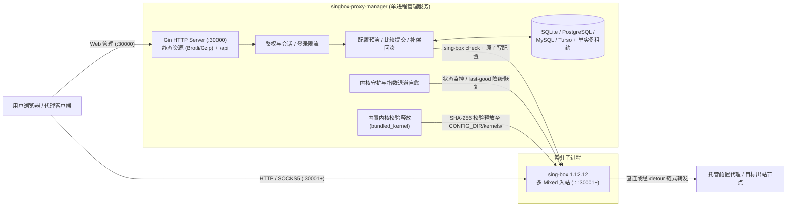

# 系统架构与核心机制

本文档基于 `1.7.24` 源码梳理 SingBox Proxy Manager 的核心架构、运行时生命周期与安全边界。

## 1. 总体定位与架构

SingBox Proxy Manager 将多个不同协议的出站代理节点统一映射为多个本地 **Mixed（HTTP + SOCKS5 共用端口）** 入站，由**单个常驻 `sing-box` 子进程**负责全部转发；Go 后端同时托管管理 API、预压缩嵌入式前端面板、数据持久化以及 `sing-box` 进程守护。

> **架构边界澄清**：本项目不是订阅分发服务器、不是桌面端系统代理切换工具，也不是“一节点一内核进程”的多实例进程池。



### 技术栈与版本基线

| 组件 | 固定基线 | 源码依据 |
| --- | --- | --- |
| 应用版本 | `1.7.24`（后端嵌入 `version.txt`） | `internal/version/version.txt` |
| Go 工具链 | **精确 `1.26.11`**（发行与内核构建强校验） | `go.mod`、`scripts/verify-go-build.sh` |
| sing-box 内核 | **固定 `1.12.12`**（Go 1.26.11 重编译） | `scripts/build-sing-box.sh` |
| 前端技术栈 | React 18、Ant Design 5、Axios、i18next、dnd-kit、Lucide、Vite 6（Node `>=22.12.0`） | `frontend/package.json` |
| 后端技术栈 | Gin、Go `database/sql`、bcrypt、`modernc.org/sqlite`、`pgx/v5`、`go-sql-driver/mysql`、`libsql-client-go` | `go.mod`、`backend/database/database.go` |

### 仓库目录职责

| 路径 | 职责说明 |
| --- | --- |
| `backend/` | HTTP 服务入口（`main.go`）、静态预压缩分发（`static_assets.go`）及各业务子包 |
| `backend/api/` | 路由处理器、会话认证、登录防爆破限流、节点与设置的变更协调（`node_mutation*.go`） |
| `backend/models/` | 节点与协议结构体、严格 JSON 校验、DDL 建表、自动迁移、查询与环境密码指纹同步 |
| `backend/database/` | 多数据库驱动选择、连接池、MySQL DSN 规范化、PostgreSQL 占位符转换（`rebind.go`）、单实例数据库租约（`instance_lease.go`） |
| `backend/services/` | `sing-box` 配置生成与进程生命周期、原子应用（`runtime_applier.go`）、日志轮转、资源/环境隔离、15 种协议链接编解码、批量导入与订阅 SSRF 防护、出口与前置 IP 检测、前置防环路 |
| `internal/kernel/` | 统一发行版内置内核嵌入、SHA-256 校验释放（`bundled_kernel` tag）；开发构建回退为空路径 |
| `internal/version/` | 应用版本读取与 GitHub Release 按需更新查询（带互斥缓存） |
| `internal/security/` | Go 标准库 X.509 与 HTTP 限制安全回归测试 |
| `frontend/` | 正式管理面板（「暮色 · Dusk」暗色界面）、构建与预压缩脚本、前端及全栈 E2E 回归脚本、Go 嵌入包装（`frontend_dist` tag） |
| `scripts/` | 固定版本内核安全重编译、单文件发行版打包、Go 构建元数据校验、Linux 发行版系统验证脚本 |

---

## 2. 统一发行版：内置内核与预压缩前端

正式发行构建（`scripts/build-release.sh`）同时开启 `frontend_dist,bundled_kernel` 两个 Go build tag，产出的单个二进制即包含全部前后端与 `sing-box` 内核。

### 2.1 内置内核校验与释放（`internal/kernel/`）

- 发行版将与当前 `GOOS/GOARCH` 匹配的 `sing-box 1.12.12` 内嵌在管理二进制中。
- 启动时，管理进程自动将其释放至：
  ```text
  <CONFIG_DIR>/kernels/sing-box-<完整 SHA-256>
  ```
- 目录与内核文件权限严格设为 `0700`，写入采用「同目录临时文件 → `Sync` → `Rename`」原子替换，并拒绝符号链接目录。
- 每次启动都会校验文件类型、体积、权限与 SHA-256；若内核文件缺失、损坏或权限异常，会自动重新释放修复。
- **优先级隔离**：统一发行版**始终使用内置内核**，不受 `SINGBOX_BINARY`、系统 `PATH` 或旧外置文件干扰。仅在不带 `bundled_kernel` tag 的开发构建中，才会依次按以下顺序查找外部内核：
  1. 显式注入路径（统一发行内置路径）
  2. 环境变量 `SINGBOX_BINARY`
  3. 系统 `PATH` 中的 `sing-box`
  4. `<CONFIG_DIR>/sing-box`
  5. 管理程序同目录的 `sing-box`
- 注意：版本升级后历史哈希命名的旧内核文件不会自动清理，可按需手动删除旧文件。

### 2.2 预压缩静态资源与内容协商（`backend/static_assets.go`）

- 前端执行 `npm run build` 时，`frontend/tools/precompress.mjs` 会为所有 `>= 1024` 字节的 `JS / CSS / SVG / JSON / TXT / MAP` 产物预先生成 `.gz`（gzip 9 级）与 `.br`（Brotli 11 级）文件，随后通过 `go:embed all:dist` 编入二进制（跳过 `.html`，避免生成启动即被 Go 改写失效的压缩副本）。
- **统一发行版始终使用嵌入前端**，避免被宿主机遗留的旧版 `frontend/dist` 覆盖；仅非统一发行开发构建允许优先读取磁盘 `frontend/dist`。
- HTTP 静态分发严格支持 `Accept-Encoding` 内容协商（解析 `q` 权重、通配符、`identity`、`x-gzip`，同权重优先 Brotli），先选定最终编码表示再按需读取目标文件（未知 MIME 仅嗅探原件前 512 字节）：
  - `GET Range` 请求自动回退至未压缩原始内容，确保分片语义正确。
  - `HEAD` 请求不输出响应体，非 `GET` 的 `Range` 头被剥离。
  - 服务端在响应首页 `index.html` 时会注入运行时 `<meta>`（如并发度、列表增量渲染阈值），注入后基于修改后的 HTML 实时生成 gzip，不复用未修改前的 `.br` 文件。
  - 首页响应设置 `ETag` 与必须重新验证的缓存策略；`/assets/*` 携带 `immutable` 一年长期缓存，并统一输出 `X-App-Version` 与 `X-Frontend-Fingerprint`。
  - 严格拒绝路径穿越与非普通文件访问；未知 `/api/*` 返回 JSON `404`，其他未知前端路径回退至首页支持 SPA。

---

## 3. 配置生成、原子变更与崩溃自愈

### 3.1 `sing-box` 配置生成规则（`backend/services/singbox.go`）

- **单进程多入站**：每个已启用节点生成一个 `mixed` 类型入站（标签 `node-<ID>-in`），同时承载 HTTP 与 SOCKS5 协议；入站监听地址固定写入 `::`（双栈监听），默认开启 `sniff` 与目标地址覆盖。
  > 注意：环境变量 `BIND_ADDRESS` **仅控制管理后台 HTTP 服务**，不影响节点代理入站的 `::` 监听地址。
- **出站映射**：常规协议生成对应 `outbounds`（标签 `node-<ID>-out`）；`wireguard` 协议按 `sing-box 1.12` 规范写入顶层 `endpoints` 而非旧版 `wireguard` outbound；配置末尾固定附加内置 `direct` 出站作为 `route.final`。
- **托管前置代理（链式转发）**：
  - 全局前置标签为 `managed-upstream-global`，节点自定义前置标签为 `node-<ID>-upstream`。
  - 普通出站通过 `detour` 串联至前置代理；`direct` 节点无法直接设 `detour`，由系统自动生成单选 `selector` 桥接至前置代理。
  - 历史遗留的 `legacy` 模式 `detour` 仍保持兼容（可按启用节点名称或标签引用），但严格拦截重名歧义、未定义目标、自引用及环路。
- **配置文件写入**：运行时配置写入 `<CONFIG_DIR>/config.json`，最近一次成功启动的快照保存为 `<CONFIG_DIR>/config.json.last-good`，均采用 `0600` 权限与「临时文件 + `Sync` + `Rename`」原子落盘。

### 3.2 变更一致性：预演、比较提交与补偿回滚

节点增删改、排序、批量导入或全局设置变更横跨数据库、本地配置文件与 `sing-box` 子进程，后端通过 `backend/api/node_mutation.go` 与 `backend/services/runtime_applier.go` 实现跨资源一致性：

1. **数据库短事务预演**：在事务中模拟写入变更并采集变更前后快照，随后回滚该预演事务，候选状态仅保留在内存。
2. **离线配置校验**：基于候选状态生成完整配置并写入临时文件，调用 `sing-box check -c <tmp>` 验证语法与协议约束（受并发槽位与硬超时控制）。
3. **原子切换内核**：校验通过后原子覆盖 `config.json`，停止旧 `sing-box` 进程并启动新进程（等待默认 `1s` 启动观察期确认稳定），成功后再写入 `config.json.last-good`。
4. **乐观比较提交**：开启新数据库事务，校验底层数据未被并发请求篡改后正式提交变更，标记内核应用阶段为 `committed`。
5. **失败自动补偿**：预演或配置校验阶段失败时不会触碰当前运行中的内核；若在切换内核或数据库提交阶段发生异常，系统会按阶段尝试补偿恢复旧 `config.json` 并拉起旧版内核进程；若补偿本身也失败，则返回错误并将运行状态标记为降级（`degraded: true`）。

> 说明：该机制确保变更具备明确的失败保护与补偿恢复语义，但切换瞬间会重建 `sing-box` 子进程，不属于零断流热重载。

### 3.3 崩溃守护与降级恢复

- **启动顺序与可恢复性**：主程序先初始化数据库、鉴权与 Web 管理界面，再启动 `sing-box`。即便 `sing-box` 启动失败，管理后台仍保持在线，允许管理员登录排查或修复配置。
- **指数退避自愈**：后台 watcher 捕获 `sing-box` 非预期退出后，按指数退避自动重试（默认最多 `5` 次，基准延迟 `1s`，序列 `1s / 2s / 4s / 8s / 16s`，默认上限 `30s`）。当发生下一次非预期退出时，若此前连续存活时长已达到 `SBPM_SINGBOX_RECOVERY_STABLE_WINDOW`（默认 `1m`），会先清零既往恢复失败计数再重新计次。
- **last-good 降级保护**：若当前配置无法启动，守护进程会尝试回退至 `config.json.last-good` 恢复代理转发；只要当前运行配置哈希（`active_config_hash`）与期望哈希（`desired_config_hash`）不一致，运行状态接口（`/api/runtime/status`）会保持 `degraded: true`，前端顶部弹出错误横幅并提供「重启内核」入口。
- **跨平台孤儿进程防护**：Linux 平台借助 `Pdeathsig` 与独立进程组；macOS / FreeBSD 平台通过父进程生命周期管道 watchdog 与进程组确保主进程退出时彻底回收 `sing-box`。主程序优雅关闭时依次排空 HTTP 连接、停止内核、取消恢复器并释放数据库租约。

---

## 4. 端口策略、TCP 复用与前置防环路

### 4.1 端口分配与固定策略

| 策略模式 | 端口行为 | 端口固定按钮（Pin） |
| --- | --- | --- |
| **自动分配模式**（`preserve_inbound_ports = false`，默认） | 新库默认起始端口为 `30001`（可配置 `1024–65535`）；新建节点自动跳过已被系统 TCP 占用及已固定的端口；删除节点、拖拽排序或部分编辑会按新顺序自动重排未固定节点的入站端口，已固定端口保持不动。 | 可用。切换固定状态仅更新数据库元数据，不立即重启内核；有筛选条件时禁用拖拽重排。 |
| **保留入站端口模式**（`preserve_inbound_ports = true`） | 排序、删除补位或修改起始端口均不会改写既有节点端口；新建/编辑允许手动指定端口（填 `0` 表示自动分配）。 | 隐藏且后端拒绝修改固定状态（返回 `409`）；允许在筛选子集内排序，由前端合并完整排列提交。 |

> 从「保留入站端口」切回「自动分配模式」会重排未固定节点端口并重启 `sing-box`，前端会弹出危险操作二次确认。

### 4.2 TCP 复用机制（多节点单端口路由）

本项目中的「TCP 复用」并非传输层多路复用（smux/yamux），而是基于 `sing-box` 入站认证用户名的**路由分发能力**：

- 对每一个已启用、配置完整入站账密且开启 `tcp_reuse_enabled` 的节点，系统自动派生复用用户名：`<原用户名>+<该节点入站端口>`（因此入站用户名禁止包含 `+`）。
- 这些复用账号会被同步注册到**所有已启用且有认证的节点入站**上。
- 路由规则中，`auth_user` 匹配优先级高于默认「入站 → 本节点出站」规则。因此客户端只需连接任意一个带认证的节点端口，更换不同的 `<用户名>+<目标端口>` 认证凭据即可路由至对应目标出站节点。
- 关闭某节点的「TCP 复用」开关，意味着将它从可被其他端口路由的目标池中移除，而不影响它作为入站转发其他复用目标。

### 4.3 托管前置代理与防环路保护（`upstream_loop_guard.go`）

节点的前置代理支持三种常规策略（及旧数据兼容的 `legacy`）：
- `none`（直连）：明确绕过全局前置代理。
- `global`（跟随全局）：当系统设置启用全局前置代理时，出站流量先经全局前置代理中转。
- `custom`（自定义）：使用该节点专属的前置代理配置，支持独立出口 IP 检测（通过临时短生命周期 `sing-box` 进程隔离探测，结束后自动清理临时目录）。

为防止配置出死循环流量，系统强制执行以下防环路规则：
1. 禁止前置代理定义与节点自身出站完全相同，禁止在前置定义内再次嵌套 `detour`。
2. 若前置目标端口命中本机任一启用入站端口，系统会解析目标主机（DNS 超时 `5s`、并发上限 `8`），一旦命中回环地址、未指定地址或本机网卡地址，直接拒绝保存（使用 TCP 复用账号同样无法绕过）。

---

## 5. 安全设计与运行边界

### 5.1 管理员认证、环境密码同步与会话控制

- **无默认密码**：新数据库（或历史遗留默认密码哈希且无环境指纹）首次启动必须通过 `ADMIN_PASSWORD` 提供非空管理员密码，上限 `72` UTF-8 字节（bcrypt 限制）。注意：环境变量初始化仅检查非空与 `<= 72` 字节；**最少 8 字符限制由管理面板与 `PUT /api/settings` 改密流程强制执行**。
- **环境变量指纹同步**：数据库以 bcrypt `DefaultCost` 独立存储「当前密码哈希」与「上次同步的环境变量密码指纹」：
  1. 已有有效密码但尚无指纹时，首次携带 `ADMIN_PASSWORD` 仅记录指纹，**不会覆盖**现有密码或踢下线。
  2. `ADMIN_PASSWORD` 与指纹一致时，重启会保留面板内修改过的新密码。
  3. 当 `ADMIN_PASSWORD` 修改为新的非空值并重启时，系统才会覆盖数据库密码、递增 `auth_generation` 并吊销全部既有会话。
  4. 密码已持久化后，`ADMIN_PASSWORD` 留空即可正常启动。
- **有状态会话**：登录后签发 32 字节随机 URL-Base64 Token，数据库仅保存其 SHA-256 哈希、有效期（默认 `168` 小时，可配 `1–8760` 小时）、`auth_generation` 以及登录 IP / User-Agent（仅用于记录，不做绑定）。每次鉴权均实时核对过期时间与代次，**无滑动续期、非 JWT**。修改管理员密码立即递增代次，使所有旧会话即刻失效。
- **登录防爆破**：按 `ClientIP()` 统计失败次数与进行中校验次数（默认 `60s` 窗口内最多 `10` 次失败，触发后封禁 `600s`），全局同时最多 `2` 个并发 bcrypt 校验，超限立即返回 `429` 与 `Retry-After` 头。默认不信任任何反代转发头，部署在反向代理后必须显式配置 `TRUSTED_PROXIES`。

### 5.2 订阅抓取 SSRF 防护与子进程隔离

- **远程订阅安全边界**（`backend/services/subscription_http.go`）：
  - 仅允许 `http://` 与 `https://`，底层 Transport 显式设置 `Proxy: nil`（不继承宿主代理）。
  - 拒绝 `localhost`、回环、私有内网、链路本地、云元数据段、保留与文档网段等全部非公网地址；DNS 返回多条记录时任一地址不安全即整体拒绝；每次重定向重新校验并直接拨号至已校验 IP。
  - 硬限制：单次请求 `15s`、整次展开 `70s`、最多 `20` 个 URL、抓取并发 `5`、单响应最大 `5 MiB`、展开深度上限 `3`、单次导入节点与错误项合计上限 `2000`，自动拦截 HTML 页面正文；订阅内容内部嵌套的 URL 禁止再次发起联网抓取。
- **内核环境变量隔离**（`backend/services/singbox_command.go`）：启动 `sing-box` 子进程时仅白名单透传 `HOME / LANG / LC_ALL / PATH / SSL_CERT_DIR / SSL_CERT_FILE / TMPDIR / TZ` 及 `SINGBOX_ENV_ALLOWLIST` 显式指定的非敏感变量；任何包含密码、Token、数据库 URL、DSN、私钥、API Key 特征的变量名即使写入白名单也会被强行剔除。
- **HTTP 安全头与 CORS 边界**：所有响应自动附加 CSP、`X-Frame-Options`、`X-Content-Type-Options: nosniff`、`Permissions-Policy`，识别 HTTPS 或反代 HTTPS 头时附加 HSTS。CORS 默认关闭，仅在配置 `CORS_ALLOWED_ORIGINS` 时做精确 Origin 匹配（忽略 `*`）；注意其允许方法列表为 `GET, POST, PUT, DELETE, OPTIONS`（不含 `PATCH`），正式前端默认以同源 `/api` 方式部署。

### 5.3 安全重编译保障（Go 1.26.11 + sing-box 1.12.12）

项目不直接下载上游预编译 `sing-box` 二进制，而是通过 `scripts/build-sing-box.sh` 校验固定模块哈希后，强制以 `Go 1.26.11`（`GOTOOLCHAIN=local`、`CGO_ENABLED=0`）重新编译管理后端与 `sing-box 1.12.12`，并在 CI 中对两者执行 `govulncheck` 二进制可达性扫描与 `scripts/verify-go-build.sh` 编译器元数据核验，确保阻断 `CVE-2026-111943`（`GO-2026-6809`）与 `CVE-2026-97054`（`GO-2026-6859`）等标准库漏洞回归。
