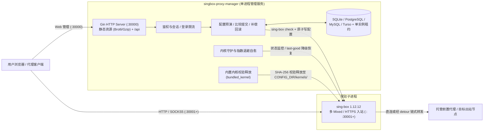

# 系统架构与核心机制

本文档基于 `1.7.37` 源码梳理 SingBox Proxy Manager 的核心架构、运行时生命周期与安全边界。

## 1. 总体定位与架构

SingBox Proxy Manager 将多个不同协议的出站代理节点统一映射为多个本地 **Mixed（HTTP + SOCKS5 共用端口）** 或 **HTTPS (TLS 加密 HTTP)** 入站，由**单个常驻 `sing-box` 子进程**负责全部转发；Go 后端同时托管管理 API、预压缩嵌入式前端面板、数据持久化以及 `sing-box` 进程守护。

> **架构边界澄清**：本项目不是订阅分发服务器、不是桌面端系统代理切换工具，也不是“一节点一内核进程”的多实例进程池。



### 技术栈与版本基线

| 组件 | 固定基线 | 源码依据 |
| --- | --- | --- |
| 应用版本 | `1.7.37`（后端嵌入 `version.txt`） | `internal/version/version.txt` |
| 容器基础镜像 | `alpine:3.24`（多架构静态二进制运行环境） | `Dockerfile`、`Dockerfile.release` |
| Go 工具链 | **精确 `1.26.11`**（发行与内核构建强校验） | `go.mod`、`scripts/verify-go-build.sh` |
| sing-box 内核 | **固定 `1.12.12`**（Go 1.26.11 重编译） | `scripts/build-sing-box.sh` |
| 前端技术栈 | React 18、Ant Design 5、Axios、i18next、dnd-kit、Lucide、Vite 6（Node `>=22.12.0`） | `frontend/package.json` |
| 后端技术栈 | Gin、Go `database/sql`、bcrypt、`modernc.org/sqlite`、`pgx/v5`、`go-sql-driver/mysql`、`libsql-client-go` | `go.mod`、`backend/database/database.go` |

### 仓库目录职责

| 路径 | 职责说明 |
| --- | --- |
| `backend/` | HTTP 服务入口（`main.go`）、自探针健康检查（`healthcheck.go`）、静态预压缩分发（`static_assets.go`）及各业务子包 |
| `backend/api/` | 路由处理器、会话认证、登录防爆破限流、节点/分组/订阅/策略/观测接口与变更协调（`node_mutation*.go`、`groups.go`、`subscriptions.go`、`policy_nodes.go`、`observability.go`） |
| `backend/models/` | 节点、分组、策略与协议结构体、严格 JSON 校验、DDL 建表、分组迁移（`group_migration.go`）、查询与环境密码指纹同步 |
| `backend/database/` | 多数据库驱动选择、连接池、MySQL DSN 规范化、独立日志库连接器（`log_target.go`）、PostgreSQL 占位符转换（`rebind.go`）、单实例数据库租约（`instance_lease.go`） |
| `backend/services/` | `sing-box` 配置生成与进程生命周期、原子应用（`runtime_applier.go`）、脱敏与日志轮转（`singbox_log.go`）、策略 SOCKS5 调度器（`policy_dispatch.go`）、按需连接监控/轻量离线客户端 IP 地区查询与日志/流量持久化（`connections.go`、`ipgeo.go`、`observability.go`、`log_store.go`、`log_query.go`）、资源/环境隔离、16 种协议链接编解码、批量导入与订阅 SSRF 防护、出口与前置 IP 检测、前置防环路 |
| `internal/agreement/` | 嵌入 `USER_AGREEMENT.md` 正文，负责首次启动终端交互确认、同意哈希落盘与 `ACCEPT_USER_AGREEMENT` 环境变量门禁 |
| `internal/kernel/` | 统一发行版内置内核嵌入、SHA-256 校验释放（`bundled_kernel` tag）；开发构建回退为空路径 |
| `internal/version/` | 应用版本读取与 GitHub Release 按需更新查询（带互斥缓存） |
| `internal/security/` | Go 标准库 X.509 与 HTTP 限制安全回归测试 |
| `frontend/` | 正式管理面板（「暮色 · Dusk」暗色界面）、构建与预压缩脚本、前端及全栈 E2E 回归脚本、Go 嵌入包装（`frontend_dist` tag） |
| `scripts/` | 固定版本内核安全重编译、单文件发行版打包、Go 构建元数据校验、Linux 发行版系统验证脚本 |

---

## 2. 统一发行版：内置内核与预压缩前端

正式发行构建（`scripts/build-release.sh`）同时开启 `frontend_dist,bundled_kernel` 两个 Go build tag，产出的单个二进制即包含全部前后端与 `sing-box` 内核。

### 2.1 内置内核校验与释放（`internal/kernel/`）

- 发行版将与当前 `GOOS/GOARCH` 匹配的 `sing-box 1.12.12` 内嵌在管理二进制中。
- 启动时，管理进程自动将其释放至：
  ```text
  <CONFIG_DIR>/kernels/sing-box-<完整 SHA-256>
  ```
- 目录与内核文件权限严格设为 `0700`，写入采用「同目录临时文件 → `Sync` → `Rename`」原子替换，并拒绝符号链接目录。
- 每次启动都会校验文件类型、体积、权限与 SHA-256；若内核文件缺失、损坏或权限异常，会自动重新释放修复。
- **优先级隔离**：统一发行版**始终使用内置内核**，不受 `SINGBOX_BINARY`、系统 `PATH` 或旧外置文件干扰。仅在不带 `bundled_kernel` tag 的开发构建中，才会依次按以下顺序查找外部内核：
  1. 显式注入路径（统一发行内置路径）
  2. 环境变量 `SINGBOX_BINARY`
  3. 系统 `PATH` 中的 `sing-box`
  4. `<CONFIG_DIR>/sing-box`
  5. 管理程序同目录的 `sing-box`
- 注意：版本升级后历史哈希命名的旧内核文件不会自动清理，可按需手动删除旧文件。
- 内置内核按 `GPL-3.0-or-later` 分发，管理器自身代码采用 MIT。GitHub Release 随裸二进制附带版权与许可证文件，源码构建与 GHCR 发行镜像均将这些文件置于 `/app/`。[第三方声明与对应源码](../THIRD_PARTY_NOTICES.md)

### 2.2 预压缩静态资源与内容协商（`backend/static_assets.go`）

- 前端执行 `npm run build` 时，`frontend/tools/precompress.mjs` 会为所有 `>= 1024` 字节的 `JS / CSS / SVG / JSON / TXT / MAP` 产物预先生成 `.gz`（gzip 9 级）与 `.br`（Brotli 11 级）文件，随后通过 `go:embed all:dist` 编入二进制（跳过 `.html`，避免生成启动即被 Go 改写失效的压缩副本）。
- **统一发行版始终使用嵌入前端**，避免被宿主机遗留的旧版 `frontend/dist` 覆盖；仅非统一发行开发构建允许优先读取磁盘 `frontend/dist`。
- HTTP 静态分发严格支持 `Accept-Encoding` 内容协商（解析 `q` 权重、通配符、`identity`、`x-gzip`，同权重优先 Brotli），先选定最终编码表示再按需读取目标文件（未知 MIME 仅嗅探原件前 512 字节）：
  - `GET Range` 请求自动回退至未压缩原始内容，确保分片语义正确。
  - `HEAD` 请求不输出响应体，非 `GET` 的 `Range` 头被剥离。
  - 服务端在响应首页 `index.html` 时会注入运行时 `<meta>`（如并发度、列表增量渲染阈值），注入后基于修改后的 HTML 实时生成 gzip，不复用未修改前的 `.br` 文件。
  - 首页响应设置 `ETag` 与必须重新验证的缓存策略；`/assets/*` 携带 `immutable` 一年长期缓存，并统一输出 `X-App-Version` 与 `X-Frontend-Fingerprint`。
  - 严格拒绝路径穿越与非普通文件访问；未知 `/api/*` 返回 JSON `404`，其他未知前端路径回退至首页支持 SPA。

---

## 3. 配置生成、原子变更与崩溃自愈

### 3.1 `sing-box` 配置生成规则（`backend/services/singbox.go`）

- **单进程多入站、HTTPS (TLS) 加密与无端口出站**：每个已启用且分配了入站端口的节点默认生成一个 `mixed` 类型入站（标签 `node-<ID>-in`），同时承载 HTTP 与 SOCKS5 协议；当 `inbound_mode = "https"` 时生成 `sing-box` 原生 `type: "http"` + `tls`（`certificate_path` / `key_path`，原生兼容现有 TCP 复用 `users` 路由，不提供 SOCKS5）。后端 `services/inbound_tls.go` 自动扫描证书与私钥目录（默认 `/app/certs` 与 `/app/keys`，支持子目录与软链接并防环限容），按 PEM 内容与 `tls.LoadX509KeyPair` 跨目录配对并按叶证书+公钥去重，唯一有效套件首次启用时自动落库稳定逻辑路径。**失效与热加载边界**：生成或重应用配置时，若选定证书丢失或已过期，系统仅省略该失效 HTTPS 入站监听器（保持出站且绝不降级明文），不阻断其他节点；运行期间同逻辑路径上的证书续签由内置 `sing-box` watcher 自动热加载（重载失败则沿用旧 TLS 配置并输出日志），更换证书路径或立即停用已过期监听器需要触发一次配置重应用。入站监听地址固定写入 `::`（双栈监听），默认开启 `sniff` 与目标地址覆盖。位于不分配端口分组内的已启用实体节点（数据库 `inbound_port IS NULL`、API 返回 `0`）不生成独立入站，但仍保留出站以供策略节点引用或隔离测 IP。
  > 注意：环境变量 `BIND_ADDRESS` **仅控制管理后台 HTTP 服务**，不影响节点代理入站的 `::` 监听地址。
- **出站映射与策略调度**：常规实体协议直接生成对应 `outbounds`（标签 `node-<ID>-out`，零额外跳转）；`wireguard` 协议按 `sing-box 1.12` 规范写入顶层 `endpoints`；配置末尾固定附加内置 `direct` 出站作为 `route.final`。仅当存在已启用策略节点（`failover` / `loadbalance` / `urltest`）时，才会额外启动管理进程内置的本机 SOCKS5 策略调度器（`127.0.0.1` 随机端口 + 随机认证密钥）并生成单个内部认证回环入站 `internal-policy-dispatch-in`，将策略出站映射到成员实体出站。
- **本机控制接口**：配置内置 `experimental.clash_api`（监听随机 `127.0.0.1` 端口与随机 Bearer 密钥），仅在面板打开「当前连接」、调用连接快照或开启日志持久化时按需采集。
- **日志分流前脱敏**：`sing-box` 子进程 stdout/stderr 在写入控制台、轮转文件及日志观测缓冲之前先经行级脱敏处理器，自动拦截 HTTP/SOCKS5 认证失败错误中携带的明文密码与本机内部控制凭据。
- **托管前置代理（三级优先级作用域）**：
  - 支持在全局（`managed-upstream-global`）、分组（`managed-upstream-group-<groupID>`）与单节点（`node-<ID>-upstream`）三个层级配置前置代理，实际仅**择一生效**（而非三跳串联），优先级固定为 **节点自定义 (`custom`) > 分组前置代理 (`group` / 分组已启用) > 全局前置代理 (`global`)**。
  - 普通出站通过 `detour` 串联至生效的前置代理；`direct` 节点无法直接设 `detour`，由系统自动生成单选 `selector` 桥接至前置代理。
  - 历史遗留的 `legacy` 模式 `detour` 仍保持兼容（可按启用节点名称或标签引用），但严格拦截重名歧义、未定义目标、自引用及环路。
- **配置文件写入**：运行时配置写入 `<CONFIG_DIR>/config.json`，最近一次成功启动的快照保存为 `<CONFIG_DIR>/config.json.last-good`，均采用 `0600` 权限与「临时文件 + `Sync` + `Rename`」原子落盘。

### 3.2 变更一致性：预演、比较提交与补偿回滚

节点增删改、排序、批量导入或全局设置变更横跨数据库、本地配置文件与 `sing-box` 子进程，后端通过 `backend/api/node_mutation.go` 与 `backend/services/runtime_applier.go` 实现跨资源一致性：

1. **数据库短事务预演**：在事务中模拟写入变更并采集变更前后快照，随后回滚该预演事务，候选状态仅保留在内存。
2. **离线配置校验**：基于候选状态生成完整配置并写入临时文件，调用 `sing-box check -c <tmp>` 验证语法与协议约束（受并发槽位与硬超时控制）。
3. **原子切换内核**：校验通过后原子覆盖 `config.json`，停止旧 `sing-box` 进程并启动新进程（等待默认 `1s` 启动观察期确认稳定），成功后再写入 `config.json.last-good`。
4. **乐观比较提交**：开启新数据库事务，校验底层数据未被并发请求篡改后正式提交变更，标记内核应用阶段为 `committed`。
5. **失败自动补偿**：预演或配置校验阶段失败时不会触碰当前运行中的内核；若在切换内核或数据库提交阶段发生异常，系统会按阶段尝试补偿恢复旧 `config.json` 并拉起旧版内核进程；若补偿本身也失败，则返回错误并将运行状态标记为降级（`degraded: true`）。

> 说明：该机制确保变更具备明确的失败保护与补偿恢复语义，但切换瞬间会强制停止并重建 `sing-box` 子进程，不属于零断流热重载。

### 3.3 崩溃守护与降级恢复

- **启动顺序与可恢复性**：主程序依次完成环境变量与时区加载、用户协议门禁、数据库与单实例租约初始化、表结构迁移、管理员密码同步、内置内核释放和 Web 路由栈准备，再尝试应用数据库配置并启动 HTTP 监听。前述基础初始化步骤失败会直接退出；若仅在应用 `sing-box` 运行配置时失败，系统会进入降级状态并继续启动管理后台，方便管理员登录排查或修复。
- **指数退避自愈**：后台 watcher 捕获 `sing-box` 非预期退出后，按指数退避自动重试（默认最多 `5` 次，基准延迟 `1s`，序列 `1s / 2s / 4s / 8s / 16s`，默认上限 `30s`）。当发生下一次非预期退出时，若此前连续存活时长已达到 `SBPM_SINGBOX_RECOVERY_STABLE_WINDOW`（默认 `1m`），会先清零既往恢复失败计数再重新计次。
- **last-good 降级保护**：若当前配置无法启动，守护进程会尝试回退至 `config.json.last-good` 恢复代理转发；只要当前运行配置哈希（`active_config_hash`）与期望哈希（`desired_config_hash`）不一致，运行状态接口（`/api/runtime/status`）会保持 `degraded: true`，前端顶部弹出错误横幅并提供「重启内核」入口。注意：包含内部策略调度入口（`internal-policy-dispatch-in`）的快照依赖内存中的策略调度器配套，冷启动无法仅凭磁盘快照重建策略转发，需从数据库重新应用。
- **跨平台孤儿进程防护**：Linux 平台借助 `Pdeathsig` 与独立进程组；macOS / FreeBSD 平台通过父进程生命周期管道 watchdog 与进程组确保主进程退出时彻底回收 `sing-box`（停止内核时采用进程组强制终止，而非代理连接优雅排空）。主程序优雅关闭时依次排空 HTTP 连接、停止内核、取消恢复器并释放数据库租约。

---

## 4. 端口策略、TCP 复用与前置防环路

### 4.1 端口分配与固定策略

| 策略模式（按分组独立配置） | 端口行为 | 端口固定按钮（Pin） |
| --- | --- | --- |
| **自动分配模式**（分组 `preserve_inbound_ports = false`，默认） | 按分组配置生效：每个分组可独立设置 `allocate_port`（是否分配端口）、`preserve_inbound_ports`（是否保留既有端口）与 `start_port`（默认首组 `30001`，范围 `1024–65535`）；开启分配时全局保持 `inbound_port` 唯一，自动跳过已被系统占用的 TCP/UDP 端口、管理后台端口及已固定/其他组占用的端口；关闭分配时组内节点端口置空（SQL `NULL`、API `0`）并自动将本组 `preserve_inbound_ports` 归零。删除、拖拽排序或本组起始端口变更仅按新顺序自动重排本组未固定节点的入站端口，已固定端口与其他分组保持不动。 | 可用。切换固定状态仅更新数据库元数据，不立即重启内核；有筛选条件时禁用拖拽重排；关闭分组端口分配时若组内存在固定端口，需显式传入 `release_pins: true`。 |
| **保留入站端口模式**（分组 `allocate_port = true` 且 `preserve_inbound_ports = true`） | 本组排序、删除补位或修改起始端口均不会改写本组既有节点端口；新建/编辑本组节点时允许手动指定端口（显式填 `0` 表示自动分配，`PUT` 省略端口字段保持原端口）。未开启分配端口时无法开启保留模式。 | 隐藏且后端拒绝修改本组节点固定状态（返回 `409`）；允许在筛选子集内排序，由前端合并完整排列提交。 |

> 在分组设置中将「保留入站端口」切回「自动分配模式」时，仅重排本组未固定节点端口、不改变其他分组的端口映射；若有效路由配置产生变化，系统会重建全局 `sing-box` 子进程（短暂中断现有连接），前端会弹出危险操作二次确认；空组或实际路由未变时仅更新元数据而不重启内核。

### 4.2 TCP 复用机制（多节点单端口路由）

本项目中的「TCP 复用」并非传输层多路复用（smux/yamux），而是基于 `sing-box` 入站认证用户名的**路由分发能力**：

- 对每一个已启用、分配了非零入站端口、配置完整入站账密且开启 `tcp_reuse_enabled` 的节点，系统派生路由用户名 `<原用户名>+<该节点入站端口>`（无端口实体节点可做策略成员，但不会生成复用路由号）。面板连接区将该值显示为可复制的「路由号」。入站用户名禁止包含 `+`。
- 这些复用账号会被同步注册到**所有已启用且有认证的节点入站**上。
- 路由规则中，`auth_user` 匹配优先级高于默认「入站 → 本节点出站」规则。因此客户端只需连接任意一个带认证的节点端口，更换不同的 `<用户名>+<目标端口>` 认证凭据即可路由至对应目标出站节点。
- 关闭某节点的「TCP 复用」开关，意味着将它从可被其他端口路由的目标池中移除，而不影响它作为入站转发其他复用目标。

### 4.3 托管前置代理与防环路保护（`upstream_loop_guard.go`）

节点的前置代理支持四种常规策略（及旧数据兼容的 `legacy`），整体遵循 **节点自定义 > 分组前置代理 > 全局前置代理** 三级优先级：
- `none`（直连）：明确绕过分组前置代理与全局前置代理。
- `group`（跟随分组）：仅使用当前所属分组的分组前置代理；若本组前置未启用则直接出站，**不回退**到系统全局前置代理。
- `global`（跟随全局）：优先使用当前所属分组已启用的分组前置代理；仅当本组未启用分组前置代理时，回退使用系统设置中的全局前置代理。
- `custom`（自定义）：最高优先级，使用该节点专属的前置代理配置并覆盖分组与全局设置；节点、分组与全局前置均支持通过临时短生命周期 `sing-box` 进程隔离检测出口 IP（结束后自动清理临时目录）。

为防止配置出死循环流量，系统强制执行以下防环路规则：
1. 禁止前置代理定义与节点自身出站完全相同，禁止在前置定义内再次嵌套 `detour`。
2. 若前置目标端口命中本机任一启用入站端口，系统会解析目标主机（DNS 超时 `5s`、并发上限 `8`），一旦命中回环地址、未指定地址或本机网卡地址，直接拒绝保存（使用 TCP 复用账号同样无法绕过）。

### 4.4 节点分组、策略节点与观测边界

- **节点分组与分组独立订阅**：四类数据库均在迁移时自动创建 `node_groups` 表并将 `1.7.29` 及更早版本的既有节点无损归入首组（继承原 `start_port`，保留全部节点 ID、端口、固定状态、账密、备注与顺序）。分组支持独立配置 `subscription_url` 与定时刷新周期；同步会自动合并订阅内「配置哈希 + 原订阅名」相同的条目，并通过四层匹配规则（① 配置哈希 + 原订阅名 → ② 双方唯一配置哈希 → ③ 双方唯一原订阅名 + 协议 + 规范化服务器 → ④ 双方唯一原订阅名 + 协议；存在身份歧义时拒绝整次同步）尽可能保留既有节点的 ID、端口、固定标记、入站模式、账密、备注、顺序与策略引用（不按订阅新顺序重排既有节点）；拉取失败、部分非法或空订阅绝不清空已有节点。
- **策略节点（`failover` / `loadbalance` / `urltest`）**：
  - 仅允许引用实体节点（支持跨组与无端口成员，禁止嵌套策略节点），前置模式固定为 `none`（转发至成员后沿用成员自身前置）。支持按分组整组关联并自动同步变动，面板点击「断链」时会将该组当前实体成员按原位置固化为独立成员保留优先级。
  - 调度器仅在建连阶段选择出口（不迁移已建立连接）：故障转移按成员顺序优先尝试健康成员；负载均衡支持轮询（`round-robin`）与目标粘性（API 字段 `consistent-hashing`，基于 Rendezvous/HRW 哈希对规范化目标主机 `SHA256(host + NUL + 成员ID)` 排名，忽略端口且域名与其解析 IP 独立计算）；最低延迟（`urltest`）将统一健康探测 `probe()` 测出的基准延迟与真实业务拨号耗时彻底分离，按基准探测延迟升序选取健康成员，并支持切换容差（`tolerance`，`0–5000ms`，默认 `50ms`，允许显式 `0`）防止小幅波动引发频繁换 IP；主用建连失败时即时顺延次快健康成员并触发紧急基准探测，未完成有效基准探测的成员排在已测健康成员之后，不健康成员留作末尾备选。
  - 健康探测仅针对已启用实体成员，周期 `10–3600s`（默认 `30s`），默认验证 `1.1.1.1:443` TCP 连通性，自定义 URL 发送 `HEAD`（接受 `200–399`、不跟随重定向）。全局探测共享 8 并发受控槽位异步执行（避免大分组串行阻塞）；完成首轮探测且无活跃连接并持续空闲达到 `max(3 × interval, 5m)` 时自动懒暂停周期探测，新流量到达立即唤醒且不阻塞转发。对 `failover`/`loadbalance`，单次请求中若后续备选成员成功连通同一目标，调度器才异步触发对先前失败成员的独立探测并回写结果，所有成员均失败则保留既有健康状态；对 `urltest`，业务拨号失败后均会按限频异步触发独立基准探测以校验成员真实可用性。
  - 删除实体成员会自动剔除策略引用，停用成员则保留引用并在运行时跳过并展示告警，确保 `sing-box check` 永不因成员变动失败。
- **当前连接与日志/流量观测机制与边界**：
  - **按需实时连接采集**：前端通过 `fetch` 读取 SSE 流（`GET /api/connections/stream`），后端以约 `1.2s` 周期采样本机 `clash_api` 并聚合为客户端、入站端口与出站/策略/前置路径快照（无 SSE 订阅者且未开启日志持久化时停止全部定时采样并回收计数器；单次 GET 轮询最多保留 5 秒速率基线）。客户端 IP 地区采用内嵌分块压缩离线国家表（`backend/services/ipgeo_data.bin`，以 `4096` 条边界项为单位独立 raw DEFLATE 压缩并驻留可执行文件只读段；仅在首次遇到公网 IP 时懒初始化 `< 1 KB` 稀疏块索引、1024 项 `/24`/`/48` 零指针定长 LRU 缓存与复用解码器，缓存未命中时按需流式解压单块、查完即丢，常驻堆内存约 `100 KiB`；内网/回环/链路本地/CGNAT 地址直接标注「内网 / LAN」且零加载开销），并在客户端卡片右侧拆分展示 Mixed 与 HTTPS 通道亮起状态及各自并发数。SSE 连接逐帧并定时复核管理员会话，登出、过期或改密后自动断开。
  - **内存日志与可选持久化**：默认不落盘，仅在内存环形缓冲中保留最近 `1000` 条日志；日志页按游标分页拉取（无实时推送）。管理员显式启用持久化后，支持本地专用 SQLite（默认 `<CONFIG_DIR>/logs.db`）、复用主库或独立数据库（SQLite / PostgreSQL / MySQL / Turso），待写日志与分钟级流量桶每 `2s`（或满 100 条日志）批量写入，每分钟按保留天数（默认 7 天）和容量上限（默认 200 MiB）清理并回收空间；前端流量页提供总量汇总与路径明细表。
  - **来自官方 `sing-box v1.12.12` 内核的诚实边界**：① 同一策略节点同时有多个不同成员并发访问完全相同的目标主机端口时，官方 `/connections` 响应未携带外层与内层连接关联 ID，系统在无法唯一配对时将 `policy_member_id` 显式置 `0` 而不做错误归因；② `/connections` 仅暴露当前活跃连接，完全落在采样间隔内的极短连接或连接关闭前最后一次采样后的尾量字节可能未计入分钟流量桶，流量统计定位于运维观测而非精确计费。

---

## 5. 安全设计与运行边界

### 5.1 管理员认证、环境密码同步与会话控制

- **无默认密码**：新数据库（或历史遗留默认密码哈希且无环境指纹）首次启动必须通过 `ADMIN_PASSWORD` 提供非空管理员密码，上限 `72` UTF-8 字节（bcrypt 限制）。注意：环境变量初始化仅检查非空与 `<= 72` 字节；**最少 8 字符限制由管理面板与 `PUT /api/settings` 改密流程强制执行**。
- **环境变量指纹同步**：数据库以 bcrypt `DefaultCost` 独立存储「当前密码哈希」与「上次同步的环境变量密码指纹」：
  1. 已有有效密码但尚无指纹时，首次携带 `ADMIN_PASSWORD` 仅记录指纹，**不会覆盖**现有密码或踢下线。
  2. `ADMIN_PASSWORD` 与指纹一致时，重启会保留面板内修改过的新密码。
  3. 当 `ADMIN_PASSWORD` 修改为新的非空值并重启时，系统才会覆盖数据库密码、递增 `auth_generation` 并吊销全部既有会话。
  4. 密码已持久化后，`ADMIN_PASSWORD` 留空即可正常启动。
- **有状态会话**：登录后签发 32 字节随机 URL-Base64 Token，前端将其保存在浏览器 `localStorage` 中并通过 `Authorization` 请求头发送（非 HttpOnly Cookie）；数据库仅保存其 SHA-256 哈希、有效期（默认 `168` 小时，可配 `1–8760` 小时）、`auth_generation` 以及登录 IP / User-Agent（仅用于记录，不做绑定）。每次鉴权均实时核对过期时间与代次，**无滑动续期、非 JWT**。修改管理员密码立即递增代次，使所有旧会话即刻失效。
- **登录防爆破**：按 `ClientIP()` 统计失败次数与进行中校验次数（默认 `60s` 窗口内最多 `10` 次失败，触发后封禁 `600s`），全局同时最多 `2` 个并发 bcrypt 校验，超限立即返回 `429` 与 `Retry-After` 头。默认不信任任何反代转发头，部署在反向代理后必须显式配置 `TRUSTED_PROXIES`。

### 5.2 订阅抓取 SSRF 防护与子进程隔离

- **远程订阅安全边界**（`backend/services/subscription_http.go`）：
  - 仅允许 `http://` 与 `https://`，底层 Transport 显式设置 `Proxy: nil`（不继承宿主代理）。
  - 拒绝 `localhost`、回环、私有内网、链路本地、云元数据段、保留与文档网段等全部非公网地址；DNS 返回多条记录时任一地址不安全即整体拒绝；每次重定向重新校验并直接拨号至已校验 IP。
  - 硬限制：单次请求 `15s`、整次展开 `70s`、最多 `20` 个 URL、抓取并发 `5`、单响应最大 `5 MiB`、展开深度上限 `3`、单次导入节点与错误项合计上限 `2000`，自动拦截 HTML 页面正文；订阅内容内部嵌套的 URL 禁止再次发起联网抓取。
- **内核环境变量隔离**（`backend/services/singbox_command.go`）：启动 `sing-box` 子进程时仅白名单透传 `HOME / LANG / LC_ALL / PATH / SSL_CERT_DIR / SSL_CERT_FILE / TMPDIR / TZ` 及 `SINGBOX_ENV_ALLOWLIST` 显式指定的非敏感变量；任何包含密码、Token、数据库 URL、DSN、私钥、API Key 特征的变量名即使写入白名单也会被强行剔除。
- **HTTP 安全头与 CORS 边界**：所有响应自动附加 CSP、`X-Frame-Options`、`X-Content-Type-Options: nosniff`、`Permissions-Policy`，识别 HTTPS 或反代 HTTPS 头时附加 HSTS。CORS 默认关闭，仅在配置 `CORS_ALLOWED_ORIGINS` 时做精确 Origin 匹配（忽略 `*`），允许方法列表为 `GET, POST, PUT, PATCH, DELETE, OPTIONS`；正式前端默认以同源 `/api` 方式部署。

### 5.3 安全重编译保障（Go 1.26.11 + sing-box 1.12.12）

项目不直接下载上游预编译 `sing-box` 二进制，而是通过 `scripts/build-sing-box.sh` 校验固定模块哈希后，强制以 `Go 1.26.11`（`GOTOOLCHAIN=local`、`CGO_ENABLED=0`）重新编译管理后端与 `sing-box 1.12.12`，并在 CI 中对两者执行 `govulncheck` 二进制可达性扫描与 `scripts/verify-go-build.sh` 编译器元数据核验，确保阻断 `CVE-2026-111943`（`GO-2026-6809`）与 `CVE-2026-97054`（`GO-2026-6859`）等标准库漏洞回归。
